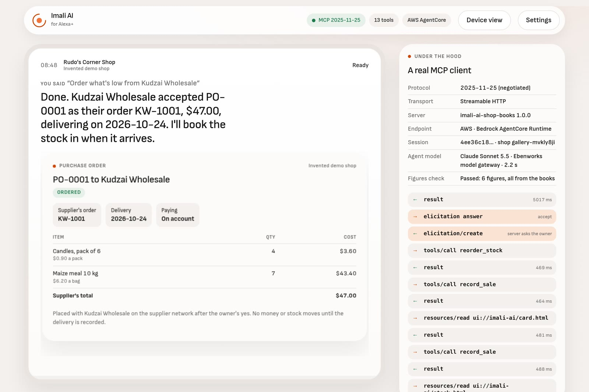
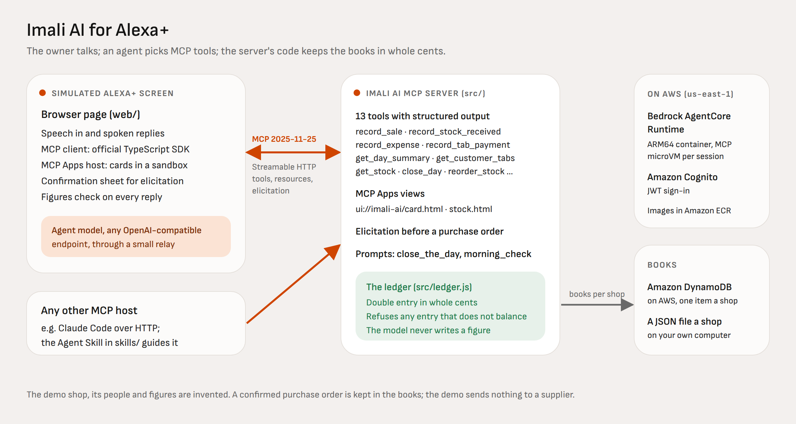

# Imali AI for Alexa+

A shop owner keeps her books by voice. She says "Sold three bread and two cooking oil, cash" to the assistant on the
counter; an agent picks a tool on the Imali AI MCP server; the server's code writes a balanced double-entry record in
whole cents and answers with a line to speak and a card to show. When stock runs low, the books server asks a second
MCP server, the supplier network, for a live quote, the owner confirms it through MCP elicitation, and the order is
placed with the supplier. The model never calculates a figure.

Built for the Amazon Developer Hackathon: Alexa+ track and the AWS Builder mini challenge.

- **Try it:** https://imali-ai-alexa-plus.vercel.app (sign in with the judge account from the testing instructions;
  everything then runs against the MCP servers on Amazon Bedrock AgentCore Runtime).
- **Watch:** https://youtu.be/7eg4CjfgeJg (2:48, recorded from the live page with live MCP and model calls).
- **Run it yourself:** `npm install && npm start` (below).



The demo shop (Rudo's Corner Shop in Harare), its customers, the supplier network and every figure are invented.

## Where each judging criterion is met

| Criterion | What to look at | Where |
|---|---|---|
| Alexa+ technology at runtime | A self-hosted MCP server on the official TypeScript SDK, spec 2025-11-25 over Streamable HTTP; the handshake test checks the negotiated version | `src/mcp.js`, `src/http.js`, `test/mcp.test.js`; film 1:35 |
| Agentic workflow across services | `reorder_stock` drafts an order from the books, asks the supplier network's MCP server for a quote, confirms with the owner, then places the order there and keeps the supplier's order number | `src/mcp.js` (reorder), `src/supplier.js`; gallery 2 and 3 |
| Purchasing | The owner confirms every purchase through MCP elicitation, with a choice of how to pay; undo and reset are confirmed the same way | `src/mcp.js`; film 0:39; gallery 2 |
| State across sessions | Each shop's books persist across sessions and microVMs (DynamoDB on AWS, one version-checked item per shop) and are tied to the signed-in user | `src/store.js`, `src/http.js`; film 1:53; gallery 6 |
| Media: cards and carousels as MCP Apps | A receipt card and a stock carousel served as `ui://` resources (`text/html;profile=mcp-app`); the carousel's Reorder button calls a tool through the host | `ui/card.html`, `ui/stock.html`; gallery 1, 3, 4 |
| Agent Skills | A skill that teaches any skills-aware agent the workflow and the rule never to state a figure of its own | `skills/imali-ai-shop-books/SKILL.md` |
| Design for voice and screen | Speech in and out, an Echo Show-style device view, a confirmation sheet you can tap or answer by voice, a guided mode that works with no model at all | `web/`; gallery 7; the live demo |
| AWS Builder | Two MCP runtimes on AgentCore (books and supplier, server-to-server MCP), Cognito JWT sign-in, DynamoDB, ECR, least-privilege IAM, one deploy script | `deploy/`; film 2:10; gallery 6 |
| Friction log | Seven entries with task, steps, expected and actual, severity, workaround and suggestion | [docs/FRICTION-LOG.md](docs/FRICTION-LOG.md) |

The film was recorded before the supplier network was added; the gallery and the live demo show it.

## Who it is for

Imali AI is an AI business operating system for small shops: one AI agent runs sales, stock, staff, suppliers and
double-entry books from a text, voice note or photo. It launched on 21 October 2026 and is live on Google Play and
WhatsApp, for shops in Africa first. The owner's problem is the same anywhere: she is serving a queue, so the books
wait until closing time, and by then the morning's sales are a guess. In the United States alone there were 151,975
convenience stores at the end of 2025, and 95,672 of them (63%) belonged to companies with ten or fewer stores
([NACS 2026 store count](https://www.convenience.org/Research/FactSheets/IndustryStoreCount)). A voice assistant on the
counter fits that owner: hands busy, eyes on the customer, books kept as she talks. Because the books are an open MCP
server, the same shop can use them from Alexa+, from Imali AI's own chat, or from any other assistant.

## Run it on your computer

You need Node.js 20 or newer and Chrome (for speech input; any modern browser works if you type).

```bash
npm install
npm start
```

Open http://127.0.0.1:8787. `npm start` bundles the MCP client for the page and starts the server: the shop books MCP
server at `/mcp`, the supplier network MCP server at `/supplier/mcp`, and the simulated screen at `/`.

- **No model key?** The page starts in guided mode: each suggestion calls its MCP tool directly, so the cards, the
  supplier quote, the elicitation sheet and memory across sessions all work with no model.
- **To talk freely,** give it any OpenAI-compatible chat endpoint with tool calling, either when starting
  (`LLM_BASE_URL=https://api.openai.com/v1 LLM_MODEL=gpt-4.1-mini LLM_API_KEY=sk-... npm start`) or under **Settings**
  on the page. A key entered in Settings stays in your browser and goes only to the endpoint you name, through the
  page's own server, which does not store it.

Books are kept as one JSON file per shop under `data/`.

| Say | What happens |
|---|---|
| "Sold three bread and two cooking oil, cash" | `record_sale`: a receipt card with the four journal lines, balanced to the cent |
| "Mai Tendai took two sugar and a bag of maize meal on credit" | a credit sale on her tab, and a low-stock warning |
| "What's running low?" | `get_stock`: the stock carousel, an MCP App with its own Reorder button |
| "Order what's low from Kudzai Wholesale" | `reorder_stock`: a quote from the supplier's MCP server, the owner's confirmation, then the supplier's order number |
| "How are we doing today?" | `get_day_summary`: sales, gross profit and what the till should hold |
| "Closing up. I counted fifty dollars in the till" | `close_day`: compares the count with the books and records any shortage |
| "Who owes me money?" | `get_customer_tabs`, still there after you close the page and come back |
| "Undo that last one" | `undo_last_entry`, after the owner confirms which entry goes |

## Run it against AWS

The two MCP servers are deployed to Amazon Bedrock AgentCore Runtime in `us-east-1`, each as its own runtime from the
same ARM64 image. Their endpoints need an Amazon Cognito access token. The hosted page at
https://imali-ai-alexa-plus.vercel.app signs in for you with the judge account; to use the AWS servers from a local
copy, start it with these two variables, open **Settings**, choose *AWS: Amazon Bedrock AgentCore Runtime* and sign in:

```bash
AWS_MCP_URL='https://bedrock-agentcore.us-east-1.amazonaws.com/runtimes/arn%3Aaws%3Abedrock-agentcore%3Aus-east-1%3A247794289304%3Aruntime%2Fimali_ai_alexa_mcp-HMEl7f6r8r/invocations?qualifier=DEFAULT' \
AWS_COGNITO_CLIENT_ID=1i6tbosvleocks39oakfjfrgeq npm start
```

The page calls AgentCore directly from the browser (AgentCore answers with CORS headers), sending the token and the
header `X-Amzn-Bedrock-AgentCore-Runtime-Custom-Shop`. On AgentCore the shop is tied to the signed-in user, so a caller
reaches only shops under their own sign-in. The books runtime calls the supplier runtime over MCP, passing the caller's
token on. A scripted client checks either endpoint end to end:

```bash
npm run smoke                                   # against http://127.0.0.1:8787/mcp
COGNITO_CLIENT_ID=1i6tbosvleocks39oakfjfrgeq COGNITO_USER=judge COGNITO_PASSWORD=... \
  sh -c 'MCP_TOKEN=$(node scripts/aws-token.mjs) MCP_SHOP_HEADER=X-Amzn-Bedrock-AgentCore-Runtime-Custom-Shop node scripts/smoke.mjs "$AWS_MCP_URL"'
```

To deploy your own copy, an administrator first makes the runtime's IAM role (trust `bedrock-agentcore.amazonaws.com`;
allow pulling the image, writing its logs, and `GetItem`/`PutItem` on the books table). Then `deploy/agentcore.sh`
does the rest with the plain AWS CLI: the DynamoDB table, the Cognito pool and app client, an ARM64 image built from a
clean copy of the commit and pushed to ECR, and the two runtimes with protocol MCP, a JWT authorizer and the shop
header allowlisted. `scripts/deploy-vercel.sh` deploys the hosted page; its model relay answers only callers whose
Cognito token it has verified. [deploy/AWS-NOTES.md](deploy/AWS-NOTES.md) lists what is deployed and what it measured.

## Use it from another assistant

Any MCP host can use the same server. With Claude Code, for example:

```bash
claude -p "Record that I sold two milk by mobile money, then tell me today's sales." \
  --mcp-config '{"mcpServers":{"imali":{"type":"http","url":"http://127.0.0.1:8787/mcp","headers":{"x-imali-shop":"my-shop"}}}}' \
  --allowedTools "mcp__imali__record_sale,mcp__imali__get_day_summary"
```

On 23 October 2026 that run negotiated protocol 2025-11-25, called `record_sale` then `get_day_summary`, and answered
"Today's sales come to $2.60, all of it from the 2 milk paid by mobile money" in 4 turns and 10.6 s (measured).

## How it works



**The books.** [src/ledger.js](src/ledger.js) is plain double-entry bookkeeping in whole cents: cash, mobile money,
customers' tabs, stock at cost, suppliers, sales, cost of goods sold, running costs, and cash over or short. Each tool
builds its entry there, and the entry is applied only if its debits equal its credits. A sale debits cash (or the
customer's tab), credits sales, and moves cost of goods out of stock at the item's cost.

**Asking instead of guessing.** A tool returns `ok: false` and one question to ask the owner when the request does not
fit the books: an item not on the stock list, a credit sale with no customer, a sale larger than the stock the books
show, money paid out of the till or the mobile wallet that is not there, or a total that differs from the price list
by more than ten percent. The owner's answer comes back as a confirming argument.

**The model never calculates a figure.** The model passes the owner's own words and numbers to the tools; the server's
code computes every total, balance, profit and quantity to order, and each tool returns the sentence to say. Before a
reply is spoken, the page checks every number written in digits against the owner's words and the tools' results for
that turn; if one does not match, it speaks the tools' own lines instead. Numbers written in words are not checked.

**The tools.** [src/mcp.js](src/mcp.js) registers 13 tools with input schemas, output schemas and annotations
(read-only, destructive). Each result carries a `speech` line, the same facts as `structuredContent`, and
`_meta.ui.resourceUri` pointing at the card that shows it. A client may name each call with a request id in `_meta`
(`io.ebenworks.imali/request-id`); a repeat of the same id is answered with the entry already recorded.

| Tool | Does |
|---|---|
| `record_sale` | A sale for cash, mobile money or on a customer's tab |
| `record_stock_received` | A delivery, paid or owed, optionally filling and closing a purchase order |
| `record_expense` | A running cost |
| `record_tab_payment` / `record_supplier_payment` | Money in from a customer's tab, money out to a supplier |
| `get_day_summary` / `get_customer_tabs` / `get_stock` | Questions answered from the books |
| `close_day` | The till count against the books, with any difference recorded |
| `reorder_stock` / `confirm_purchase_order` | A quoted purchase order the owner confirms, placed with the supplier |
| `undo_last_entry` / `reset_demo_shop` | Putting things right, after the owner confirms |

**Orchestration across two MCP servers.** [src/supplier.js](src/supplier.js) is the supplier network's own MCP server
(an invented wholesaler and bakery) with `quote_order` and `place_order`. The books server is its MCP client: for a
reorder it drafts the order, asks for a quote (the supplier may fill only part of a line), shows the owner the quote
through elicitation, and after the yes places the order, which the supplier records once per purchase order number.
The supplier's order number and delivery date go into the books; stock and money move only when the delivery is
recorded. If the supplier cannot be reached, the order stays in the books only and the owner is told.

**Elicitation.** The reorder form has a confirm field and a titled single-select for how to pay (the 2025-11-25
schema). A client without elicitation gets the quote back as a draft and confirms it with `confirm_purchase_order`
after the owner says yes. Undo and reset ask the same way.

**MCP Apps.** The two views in [ui/](ui/) are served as `ui://imali-ai/card.html` and `ui://imali-ai/stock.html` with
MIME type `text/html;profile=mcp-app`. They speak the MCP Apps `ui/` protocol (2026-01-26) by `postMessage`, written by
hand with no third-party code. The simulated screen is the host: it reads the resource, renders it in a sandboxed
iframe (scripts only, no same origin) and answers the view's requests, including `tools/call`.

**State across sessions.** The client names its shop with a header; the server loads that shop's books at the start of
every tool call and saves them after. Locally that is a JSON file per shop; on AWS it is one DynamoDB item per shop,
written only if nobody changed it since it was read. On AWS the shop name is prefixed with the signed-in user.

## Tests and measurements

```bash
npm test     # 28 tests: the ledger, both MCP servers end to end over HTTP with the official client, the relay, the sign-in check
```

The end-to-end tests check that the handshake negotiates 2025-11-25, that every tool and both views are listed, that a
sale balances, that books persist across sessions and stay apart between shops, that the reorder quotes, confirms and
places the order with the supplier, that an unreachable supplier leaves the order in the books with a warning, that
undo and reset ask first, that a repeated request id is recorded once, that stock and cash cannot go below zero
unasked, that the relay never sends its key to a caller's endpoint, and that a forged or wrong sign-in is refused.

Measured on 23 October 2026, from a workstation in Korea:

- All 28 tests pass.
- AgentCore in us-east-1, two runs on warm runtimes: single tool calls 0.46 to 1.01 s; a new session's `initialize`
  1.2 to 2.3 s; the whole reorder across both servers (quote, confirmation, order) 3.5 s. A cold start is about 7 s.
- The hosted page, signed in as the judge, with the agent model (Claude Sonnet 5.5 through our model gateway), two runs
  of four requests: everyday requests took 6.5 to 8.2 s from request to spoken reply, the reorder through the supplier
  9.6 to 10.4 s, and every reply passed the figures check.

## Repository map

| Path | What |
|---|---|
| `src/` | The books MCP server, the supplier network MCP server, the ledger, storage, the HTTP transport, the model relay and sign-in check |
| `ui/` | The two MCP Apps views |
| `web/` | The simulated Alexa+ screen (`web/vendor/` is built by `npm run build`) |
| `api/` | The hosted page's model relay (a Vercel function) |
| `skills/imali-ai-shop-books/` | The Agent Skill |
| `deploy/` | The AgentCore Dockerfile, deploy script and notes |
| `scripts/` | The smoke client, the Cognito sign-in helper, the page's bundler, the hosted page's deploy |
| `test/` | The tests |
| `tools/` | How the film and the gallery were made from the live page |
| `docs/` | The architecture picture and the friction log |

## Licence

MIT, © 2026 Ebenworks Systems (Private) Limited. Imali AI is an Ebenworks product. The Sofia Sans font is under the
SIL Open Font License (`web/fonts/OFL-SofiaSans.txt`).
