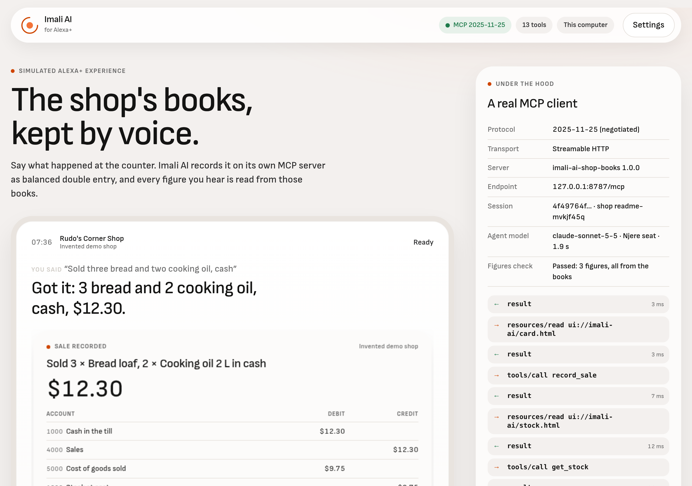

# Imali AI for Alexa+

A shop owner keeps her books by voice. She says "Sold three bread and two cooking oil, cash" to the assistant on the
counter; an agent picks a tool on the Imali AI MCP server; the server's code writes a balanced double-entry record in
whole cents and answers with a line to speak and a card to show. The model never writes a figure.

This repository holds three things, all built for the Amazon Developer Hackathon (Alexa+ track and the AWS Builder
mini challenge):

- **A self-hosted MCP server** on the official TypeScript SDK, implementing MCP spec **2025-11-25** over
  **Streamable HTTP**: 13 tools with structured output, two MCP Apps views (a receipt card and a stock carousel),
  elicitation before a purchase order counts, a journal resource, two prompts, and books kept per shop across sessions.
- **A simulated Alexa+ experience**: a web page that is a real MCP client (initialize, tools/list, tools/call,
  resources/read, elicitation), with speech in through the browser's speech recognition, spoken replies, Alexa-style
  cards rendered as an MCP Apps host, and a figures check on every reply. Amazon's Alexa+ developer tools are open to
  select partners only, so this follows the hackathon's simulated-experience path.
- **AWS hosting**: the same server on **Amazon Bedrock AgentCore Runtime** (stateful MCP sessions, one microVM per
  session), signed in with **Amazon Cognito**, with the books in **Amazon DynamoDB**.

There is also an [Agent Skill](skills/imali-ai-shop-books/SKILL.md) for the same workflow, so any agent that loads
skills knows which tool to call and that it must never state a figure of its own.



The demo film (2:48, recorded from the live page with live MCP and model calls): https://youtu.be/7eg4CjfgeJg

The demo shop (Rudo's Corner Shop in Harare), its customers, supplier and figures are invented.

## Run it on your computer

You need Node.js 20 or newer and Chrome (for speech input; any modern browser works if you type).

```bash
npm install
LLM_BASE_URL=https://api.openai.com/v1 LLM_MODEL=gpt-4.1-mini LLM_API_KEY=sk-... npm start
```

Open http://127.0.0.1:8787. `npm start` bundles the MCP client for the page and starts the server, which serves the
MCP endpoint at `/mcp` and the simulated screen at `/`. The agent model is any OpenAI-compatible chat completions
endpoint with tool calling: set the three variables above, or start with no variables and enter your own endpoint,
model and key under **Settings** on the page (they stay in your browser and go to the endpoint you name, through the
page's own server, which does not store them). Books are kept as one JSON file per shop under `data/`.

Press the microphone and say what happened, or type it, or tap one of the suggestions:

| Say | What happens |
|---|---|
| "Sold three bread and two cooking oil, cash" | `record_sale`: a receipt card with the four journal lines, balanced to the cent |
| "Mai Tendai took two sugar and a bag of maize meal on credit" | a credit sale on her tab, and a low-stock warning |
| "What's running low?" | `get_stock`: the stock carousel, an MCP App with its own Reorder button |
| "Order what's low from Kudzai Wholesale" | `reorder_stock` drafts a purchase order sized to a week of sales, then the server asks the owner to confirm it through elicitation |
| "How are we doing today?" | `get_day_summary`: sales, gross profit and what the till should hold |
| "Closing up. I counted fifty dollars in the till" | `close_day`: compares the count with the books and records any shortage |
| "Who owes me money?" | `get_customer_tabs`, still there after you close the page and come back |

## Run it against AWS

The server is deployed to Amazon Bedrock AgentCore Runtime in `us-east-1`. Its endpoint needs a Cognito access token,
and the simulated screen can sign in for you: under **Settings**, choose *AWS: Amazon Bedrock AgentCore Runtime* and
enter the judge's user name and password from the submission's testing instructions. The page then talks to AgentCore
directly from the browser (AgentCore answers browser requests with CORS headers), sending the token and the header
`X-Amzn-Bedrock-AgentCore-Runtime-Custom-Shop` to pick a shop. Start the local server with these two variables so
the page knows where AWS is:

```bash
AWS_MCP_URL='https://bedrock-agentcore.us-east-1.amazonaws.com/runtimes/arn%3Aaws%3Abedrock-agentcore%3Aus-east-1%3A247794289304%3Aruntime%2Fimali_ai_alexa_mcp-HMEl7f6r8r/invocations?qualifier=DEFAULT' \
AWS_COGNITO_CLIENT_ID=1i6tbosvleocks39oakfjfrgeq npm start
```

A scripted client checks any endpoint end to end, local or AWS:

```bash
npm run smoke                                   # against http://127.0.0.1:8787/mcp
COGNITO_CLIENT_ID=1i6tbosvleocks39oakfjfrgeq COGNITO_USER=judge COGNITO_PASSWORD=... \
  sh -c 'MCP_TOKEN=$(node scripts/aws-token.mjs) MCP_SHOP_HEADER=X-Amzn-Bedrock-AgentCore-Runtime-Custom-Shop node scripts/smoke.mjs "$AWS_MCP_URL"'
```

To deploy your own copy, an administrator first makes the runtime's IAM role (trust `bedrock-agentcore.amazonaws.com`;
allow pulling the image, writing its logs, and `GetItem`/`PutItem` on the books table), then `deploy/agentcore.sh`
does the rest with the plain AWS CLI: the DynamoDB table, the Cognito pool and app client, an ARM64 image built from
a clean copy of the commit and pushed to ECR, and the AgentCore runtime with protocol MCP, a JWT authorizer and the
shop header allowlisted. [deploy/AWS-NOTES.md](deploy/AWS-NOTES.md) lists what is deployed and what it measured.

## Use it from another assistant

Any MCP host can use the same server. With Claude Code, for example:

```bash
claude -p "Record that I sold two milk by mobile money, then tell me today's sales." \
  --mcp-config '{"mcpServers":{"imali":{"type":"http","url":"http://127.0.0.1:8787/mcp","headers":{"x-imali-shop":"my-shop"}}}}' \
  --allowedTools "mcp__imali__record_sale,mcp__imali__get_day_summary"
```

On 23 October 2026 that run negotiated protocol 2025-11-25, called `record_sale` then `get_day_summary`, and answered
"Today's sales come to $2.60, all of it from the 2 milk paid by mobile money" in 4 turns and 10.6 s (measured).

## How it works


**The books.** [src/ledger.js](src/ledger.js) is plain double-entry bookkeeping in whole cents: cash, mobile money,
customers' tabs, stock at cost, suppliers, sales, cost of goods sold, running costs, and cash over or short. Each tool
builds its entry there, and the entry is applied only if its debits equal its credits. A sale debits cash (or the
customer's tab), credits sales, and moves cost of goods out of stock at the item's cost.

**The tools.** [src/mcp.js](src/mcp.js) registers the tools with input schemas, output schemas and annotations
(read-only, destructive). Each result carries a `speech` line built from the books, the same facts as
`structuredContent`, and `_meta.ui.resourceUri` pointing at the card that shows it. When a tool cannot proceed it
returns `ok: false` and the one question to ask, instead of guessing: an item that is not on the stock list, a credit
sale with no customer, a price that does not match what was paid.

| Tool | Does |
|---|---|
| `record_sale` | A sale for cash, mobile money or on a customer's tab |
| `record_stock_received` | A delivery, paid or owed, optionally filling a purchase order |
| `record_expense` | A running cost |
| `record_tab_payment` / `record_supplier_payment` | Money in from a customer's tab, money out to a supplier |
| `get_day_summary` / `get_customer_tabs` / `get_stock` | Questions answered from the books |
| `close_day` | The till count against the books, with any difference recorded |
| `reorder_stock` / `confirm_purchase_order` | A purchase order the owner confirms before it counts |
| `undo_last_entry` / `reset_demo_shop` | Putting things right |

**Elicitation.** `reorder_stock` drafts the order, saves it as a draft, and then sends `elicitation/create` to the
client with a form: confirm, and how the shop will pay (a titled single-select from the 2025-11-25 schema). Only an
accepted answer confirms it; a declined one cancels it. A client without elicitation gets the draft back and can
confirm it with `confirm_purchase_order` after the owner says yes. A confirmed order moves no money and no stock;
`record_stock_received` books the delivery when it comes. The demo sends nothing to a supplier.

**MCP Apps.** The two views in [ui/](ui/) are served as `ui://imali-ai/card.html` and `ui://imali-ai/stock.html` with
MIME type `text/html;profile=mcp-app`. They speak the MCP Apps `ui/` protocol (2026-01-26) by `postMessage`, written
by hand with no third-party code: `ui/initialize`, then the host sends `ui/notifications/tool-input` and
`tool-result`, and the view reports its height. The stock carousel's Reorder button asks the host for `tools/call`
on `reorder_stock`, so the purchase flow can start from the card. The simulated screen is the host: it reads the
resource, renders it in a sandboxed iframe (scripts only, no same origin) and answers the view's requests.

**State across sessions.** The client names its shop with a header; the server loads that shop's books at the
start of every tool call and saves them after. Locally that is a JSON file per shop; on AWS it is one DynamoDB item
per shop, written only if nobody changed it since it was read. A new MCP session, a new browser, or another
assistant all see the same books.

**The figures check.** The page's agent model only chooses tools and words. Before a reply is spoken, every number
in it must appear in the owner's words or in what the tools returned in that turn; if one does not, the page speaks
the tools' own lines instead and says so in the log.

## Tests and measurements

```bash
npm test     # 17 tests: the ledger, and the server end to end over HTTP with the official MCP client
```

The end-to-end tests check that the handshake negotiates 2025-11-25, that every tool and both views are listed, that
a sale is balanced, that books persist across sessions and stay apart between shops, that elicitation confirms or
cancels an order, that a client without elicitation can confirm a draft, and that closing the day records a shortage.

Measured on 23 October 2026: all 17 tests pass. In the browser on the local server, with the agent model on Claude
Sonnet 5.5 through our model service, six spoken requests in a row each took 4.9 to 6.1 s from request to spoken
reply, and every reply passed the figures check. Against AgentCore in `us-east-1`, measured from Korea, tool calls
took 0.44 to 0.96 s, a warm `initialize` 1.3 to 2.6 s, and a cold start about 7 s ([deploy/AWS-NOTES.md](deploy/AWS-NOTES.md)).

## Repository map

| Path | What |
|---|---|
| `src/` | The MCP server: tools, ledger, storage, HTTP transport, entry point |
| `ui/` | The two MCP Apps views |
| `web/` | The simulated Alexa+ screen (`web/vendor/` is built by `npm run build`) |
| `skills/imali-ai-shop-books/` | The Agent Skill |
| `deploy/` | The AgentCore Dockerfile, deploy script and notes |
| `scripts/` | The smoke client, the Cognito sign-in helper, the page's bundler |
| `test/` | The tests |
| `tools/video/` | How the demo film was made: Murf voices, a recorder that plays each line into the live page, the mixer |

## Licence

MIT, © 2026 Ebenworks Systems (Private) Limited. Imali AI is an Ebenworks product. The Sofia Sans font is under the
SIL Open Font License (`web/fonts/OFL-SofiaSans.txt`).
